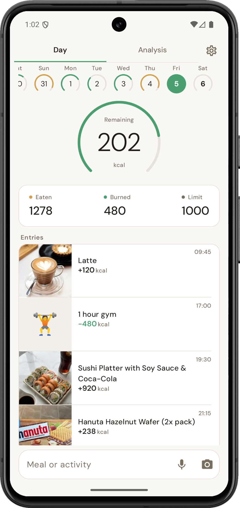
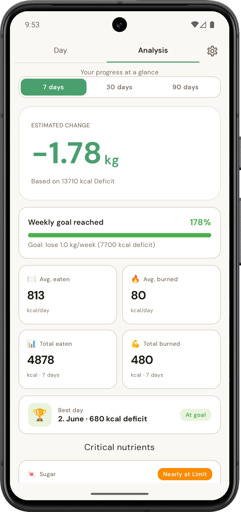
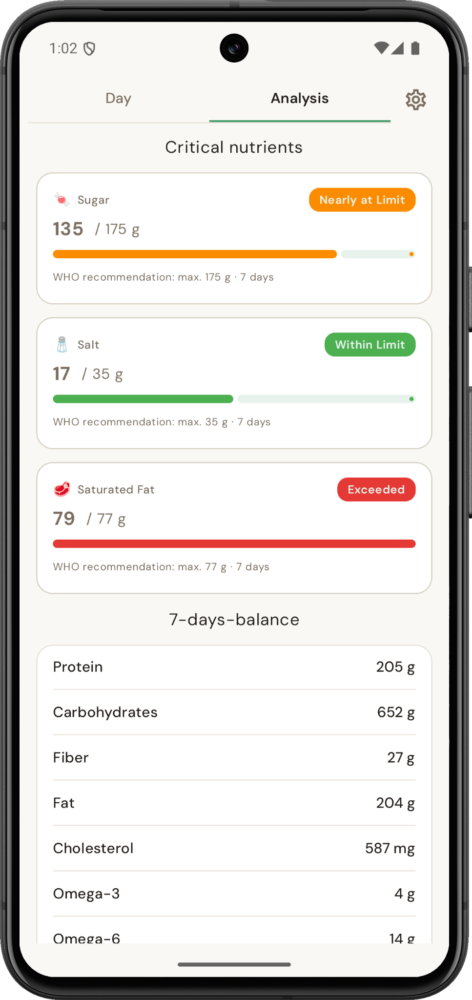
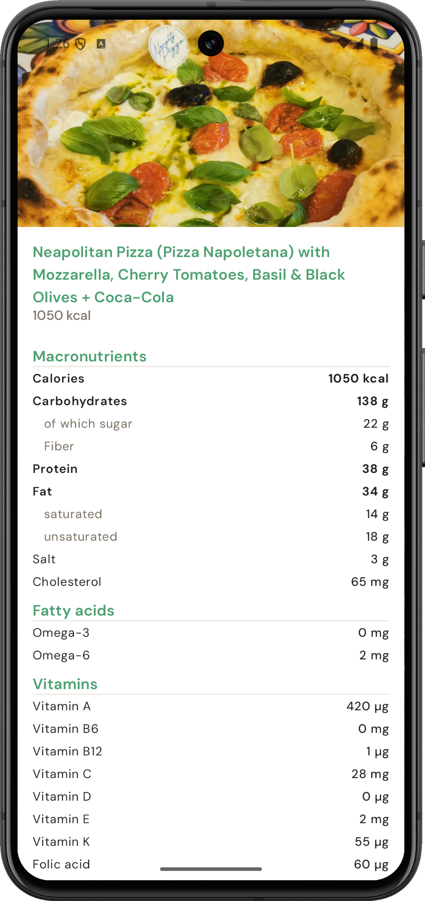

# Foodify


**AI-powered nutrition tracking for Android**, built with **Kotlin Multiplatform** and **Jetpack Compose**.

Foodify helps users log meals and activities, estimate nutritional values, and track their progress — with no account or subscription required.

**[Get Foodify on Google Play](https://play.google.com/store/apps/details?id=com.eddiapps.foodify)**

## Screenshots

<p align="center">
  <a href="assets/screenshots/daily-overview.png"></a>
  <a href="assets/screenshots/progress-analysis.png"></a>
  <a href="assets/screenshots/nutrient-analysis.png"></a>
  <a href="assets/screenshots/ai-meal-analysis.png"></a>
</p>

## Features

- **AI-assisted food logging** — enter meals and activities using text, voice, or photos
- **Barcode scanning** — look up packaged food information using Open Food Facts
- **Calorie tracking** — see consumed, burned, and remaining calories at a glance
- **Progress insights** — review 7-, 30-, and 90-day trends and estimated weight changes
- **Nutrient analysis** — examine macros, micronutrients, and critical nutrient limits
- **Privacy-conscious design** — no account required; nutrition data is stored locally, while AI requests are processed by external services
- **12 languages** — German, English, Spanish, French, Italian, Brazilian Portuguese, Hindi, Turkish, Polish, Russian, Dutch, and Indonesian

## Tech Stack

| Area | Technologies |
| --- | --- |
| **Platform** | Kotlin Multiplatform (Android release) |
| **UI** | Jetpack Compose, Material 3 |
| **Architecture** | Clean Architecture, MVVM |
| **Dependency Injection** | Koin |
| **State Management** | Kotlin Coroutines, Flow, StateFlow |
| **Networking** | Ktor, Open Food Facts API, Firebase Cloud Functions, Anthropic API |
| **Local Storage** | DataStore |
| **Image Loading** | Coil 3 |
| **Barcode Scanning** | Google ML Kit |
| **Analytics** | Firebase Analytics |
| **Testing** | JUnit, Coroutines Test, Compose UI Test |
| **CI/CD** | GitHub Actions |

## Architecture

Foodify follows a layered architecture with a clear separation of responsibilities:

- `presentation/` — Jetpack Compose UI, ViewModels, UI state
- `domain/` — business models, repository interfaces, calculation logic
- `data/` — repository implementations, local storage, remote data sources

ViewModels depend on repository interfaces rather than concrete implementations. Koin provides dependencies, and `StateFlow` exposes reactive UI state.

### AI Integration & API Key Security

AI requests are routed through **Firebase Cloud Functions** to the **Anthropic API**. The Anthropic API key remains on the server side and is **not embedded in the Android app**.

```text
Android app
    |
    v
Firebase Cloud Function (server-side API key)
    |
    v
Anthropic API
    |
    v
Nutrition estimate returned to the app
```

User data is stored locally, but content submitted for AI analysis must be transferred for processing. See the [Privacy Policy](PRIVACY.md) for details.

## Testing

- **Unit tests** for nutrition and calculation logic
- **ViewModel tests** using fake repositories
- **Compose UI tests** for key UI components
- **GitHub Actions** for automated checks on push

**Developed by [Erduan Ramadani](https://github.com/erduan-ramadani)** · **[Google Play](https://play.google.com/store/apps/details?id=com.eddiapps.foodify)**
